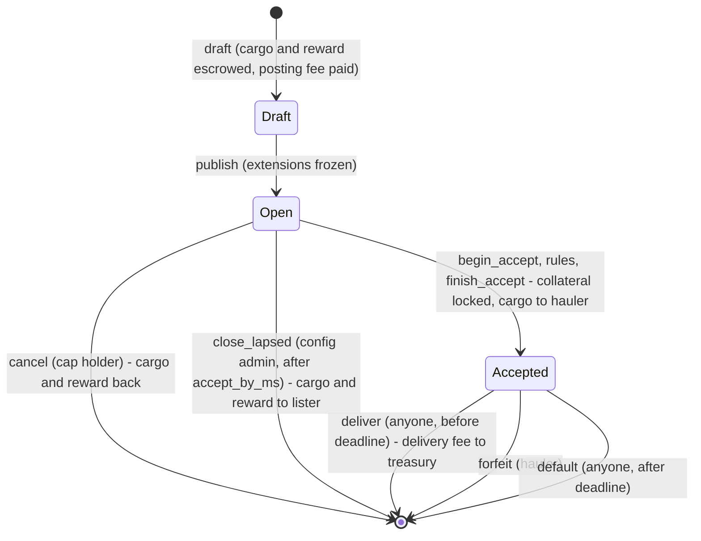
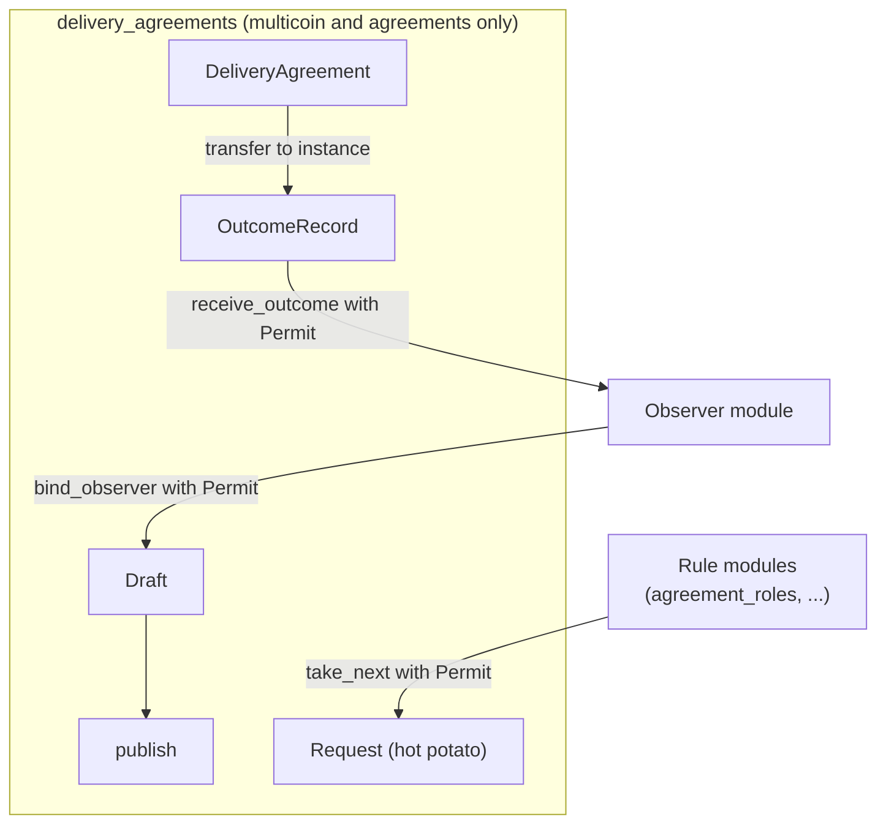

# Delivery agreements: design

How delivery agreements work, why they are built this way, and how they are meant to be extended and composed. For step-by-step usage, see [user-paths.md](user-paths.md).

## What it is

A **delivery agreement** is a collateralized forward swap of items, paid in a coin. Items are [multicoin](https://github.com/Algorithmic-Warfare/multicoin) balances; payments are a Sui `Coin<T>` of one coin type `T`, so the agreement is a `DeliveryAgreement<T>`. The lister escrows `cargo` (a multicoin balance) and a `reward` (a `Coin<T>`) and names a `want`: an exact collection, asset and quantity that counts as delivery. A hauler locks collateral, an agreed amount of `T`, and takes the cargo. Delivering the `want` before the deadline pays the hauler; missing it pays the beneficiary. `T` must be a currency the protocol admin has approved (see [Currencies and protocol fees](#currencies-and-protocol-fees)).

With [warehouse receipts](https://github.com/loash-industries/warehouse-receipts), a collection identifies a storage unit (SSU) and an asset ID an item type. `cargo` in SSU A's collection and `want` in SSU B's describe a haul from A to B.

**Contracts and agreements.** A *contract* settles when it executes, as a Trinary Exchange fill does. An *agreement* has an obligation that outlives the transaction that creates it. The chain can enforce an agreement's stakes but not the parties' conduct in the game, so delivery_agreements enforces stakes and judges performance by an objective test.

## Principles

1. **The core enforces stakes, not conduct.** Nothing leaves escrow except through the agreement's rules. How goods travel is the hauler's business.
2. **Delivery is objective.** A balance's type and amount either match `want` or they don't, so normal operation needs no adapter, oracle or judge.
3. **Time always ends an agreement.** Every accepted agreement ends through `deliver` before the deadline or `default` after it. An open agreement nobody accepts ends when the cap holder cancels it or, once `accept_by_ms` passes, when the config admin closes it with `close_lapsed`, which returns the escrow to the lister. No party or extension can keep funds locked forever.
4. **Extensions are opt-in, fixed when the agreement forms, and can't block an ending.** Rules can refuse an accept; observers only receive records.
5. **One authorization mechanism.** Every extension point is gated by `std::internal::Permit<T>`, which only the module defining `T` can create.
6. **The core depends only on multicoin and the shared `agreements` primitive.** Anything that needs armature, world-contracts or another system lives in an extension package.

## Package layout

| Path | Contents |
|---|---|
| [`packages/primitives/agreements`](../../packages/primitives/agreements) | What every agreement type shares: `request`, `requirement`, `spec` and `payout` |
| [`packages/composites/delivery_agreements`](../../packages/composites/delivery_agreements) | The core: `delivery`, and `config` for approved currencies and protocol fees |
| [`packages/composites/delivery_agreements/tests/test_extensions.move`](../../packages/composites/delivery_agreements/tests/test_extensions.move) | Minimal test extensions: an allowlist, an identity rule, a follow-up rule and a ledger observer |
| [`packages/extensions/agreement_roles`](../../packages/extensions/agreement_roles) | A claim gate that limits an agreement to a list of principals: one player (a reservation), machine keys, or an OU's board |
| [`packages/primitives/roles`](../../packages/primitives/roles) | The shared `Principal` used by `agreement_roles`; `armature_vault` switches to it at its next fresh publish |

## The core agreement

### Lifecycle



`Draft` exists only within one transaction. *Lapsed* (open past `accept_by_ms`) and *overdue* (accepted past `deadline_ms`) aren't stored states; they are derived from the clock.

### Who receives what

| Ending | Cargo | Reward | Collateral |
|---|---|---|---|
| `cancel` | Returned to the cap holder | Returned to the cap holder as a `Coin<T>` | Never posted |
| `close_lapsed` | Sent to the lister | Sent to the lister as a `Coin<T>` | Never posted |
| `deliver` | Already the hauler's; the `want` goes to the beneficiary | Hauler, less the delivery fee, which goes to the treasury | Hauler |
| `forfeit`, `default` | Kept by the hauler | Beneficiary | Beneficiary |

Every ending deletes the agreement, so each pays out exactly once. Reward, collateral and delivery fee are paid as `Coin<T>`, and a zero amount isn't sent, so nobody receives an empty coin. The posting fee went to the treasury at `draft`, whatever the ending.

### Time rules

| Check | Allowed when |
|---|---|
| Accept | `now < accept_by_ms` |
| Deliver | `now < deadline_ms`, where `deadline_ms = accepted_at + haul_ms` |
| Forfeit | Any time after accept (hauler only) |
| Default | `now >= deadline_ms` |
| Cancel | Any time while open |
| Close lapsed | `now >= accept_by_ms` while open (config admin only) |

The accept window (`accept_by_ms` from drafting) and `haul_ms` are each at most 30 days (`max_duration_ms`); `draft` aborts with `EInvalidTerms` otherwise.

### Pricing is the lister's job

Once the cargo is released, collateral is the lister's only protection. There's no oracle, so collateral below the cargo's value plus the reward makes keeping the cargo the hauler's rational choice. The contract also doesn't check that a collection is a real warehouse-receipt vault; both sides should verify collections before committing.

### Currencies and protocol fees

The `config` module creates one shared `Config` at publish. It holds the approved currencies, the posting fee, the delivery fee rate and the treasury that receives both fees. There's no public constructor, so every agreement is drafted against that config. It starts with no currencies, no fees and the publisher as treasury, so nothing can be drafted until a currency is approved.

- **Approved currencies.** An agreement's reward, collateral and delivery fee are all in its coin type `T`, and `draft` aborts with `ECurrencyNotApproved` unless `T` is approved. Revoking a currency stops new agreements in it; agreements already drafted in it run to the end unchanged.
- **Items stay multicoin.** `cargo`, `want` and the delivered balance are multicoin balances described by `Spec`s. Only payments are coins.

| Fee | Paid by | When | Amount |
|---|---|---|---|
| Posting fee | Lister | `draft` | Flat: exactly the configured amount, in the one coin type `F` the config names. Not refunded on cancel. |
| Delivery fee | Hauler, out of the reward | `deliver` | `floor(reward * delivery_fee_bps / 10,000)`, in `T` |

- **`draft<T, F>` and `post<T, F>` take `config: &Config, post_fee: Coin<F>`** after `beneficiary`. The posting fee goes to the treasury in `draft`. With no posting fee set, pass an empty coin of any type.
- **Terms are fixed at drafting.** Each agreement copies the delivery rate and treasury (and records the posting fee it paid), so later config changes never alter an existing agreement, open or accepted.
- **Other endings take no fee.** `default`, `forfeit`, `cancel` and `close_lapsed` take none, and don't refund the posting fee.
- **The `AdminCap`** changes the config with `approve_currency<T>`, `revoke_currency<T>`, `set_post_fee<F>` (a fee must be more than 0), `clear_post_fee`, `set_delivery_fee_bps` (at most 10,000) and `set_treasury`. Each emits `ConfigUpdated` with the whole config, including the currency list. The publisher receives the cap; it has `store`, so a DAO can hold it.
- **The `AdminCap` also closes lapsed agreements.** `delivery::close_lapsed` deletes an open agreement once `accept_by_ms` has passed, for listings whose `ListerCap` is lost or held by a wrapper that can't cancel. The cargo and reward go to the agreement's `lister`, never to the admin.

## Extensions



### Draft, then publish

`draft` returns a `Draft` with no abilities, which wraps the unshared agreement. The transaction that drafts must `publish` it, so extensions can only be attached in between, and everything is fixed before anyone else can see or fund the agreement. `post` is `draft` plus `publish` for an agreement with no extensions.

### Bindings

```move
public struct Binding has store, copy, drop {
    kind: TypeName,     // the extension's marker type; only its module can create Permit of it
    instance: ID,       // which observer of that kind, e.g. a registry object
    fee: Option<Spec>,  // what the extension declared it collected when binding
}
```

- **`kind` says which module may act; `instance` says which instance of it.** Many ledgers can share one observer module, so the agreement records which one receives its records.
- **The split of responsibility is explicit.** The core checks that a permit's type and the receiving instance match the binding. The extension's module must check that its caller speaks for the instance.
- **Extension fees are collected by the extension, not the core.** The extension takes its fee in its own bind function and declares it, so the core never holds extension funds. The declared fee is taken on trust.

### Accept requirements

Adapted from world-contracts `dev` (`core::request`, `core::requirement`, `core::action`) into the [`agreements`](../../packages/primitives/agreements) primitive, so every agreement type shares them and one rule can gate them all. world's `request::new` is package-only and `entity::new` is admin-gated, so world's types can't be reused directly.

- **A `Requirement`** is `{ type_name, data }`. `type_name` is the config type's `with_original_ids` name, which is stable across upgrades. `data` is the config encoded as BCS.
- **A `Request`** is created by `begin_accept` and holds the agreement ID, the action, the actor (the sender), the identity rule and the outstanding requirements. It has no abilities, so the transaction can't end without completing it.
- **Actions are marker types.** `delivery` defines `AcceptAction`. `request::new` and `request::complete` take `Permit` of the action, so only `delivery` can open or complete its own requests, and an auction or exchange defines its own actions the same way.
- **Ordering.** Requirements resolve in declaration order. A rule calls `take_next(Permit<T>)`, which aborts unless the next requirement's type is `T`.
- **Follow-ups.** `take_next` returns a `Frame`. A rule can `require` more requirements on it and `enqueue` it, and they resolve next, in the order added. Inventory in world-contracts uses this to add sponsor and online checks. A frame records the agreement and action of its request, and `enqueue` aborts with `EWrongFrame` for any other, so a rule that leaks its frame can't let a caller move follow-ups elsewhere.
- **Completion.** `finish_accept` completes the request against **this agreement and this action**, so a request satisfied against a loosely gated agreement, or opened for another action or agreement type, can't be finished here. It re-checks the agreement's state.
- **No bypass.** `accept` is begin plus finish with no rules satisfied in between, so it aborts when requirements exist.
- **No lock.** World locks an entity while a request is open. Here a request can't outlive its transaction and finishing re-checks state, so a lock would never be visible.
- **Identity.** `require_identity_to_accept` names one rule that may call `set_identity`, for example with the character ID behind a world `AccessCap`. If an identity rule is named, accepting aborts until it records one. The identity appears in events and outcome records, together with the identity rule that attested it, and reputation should be keyed by it: a wallet address costs nothing to replace. The lister picks the identity rule and can attach it after an observer binds, so an observer must check `record_identity_rule` against rules it trusts. A rule can read `request.identity_rule()` to tell whether it is expected to set the identity.
- **Discovery.** `AgreementPosted` carries the full requirement list. A client maps each `type_name` to a satisfy call it knows how to build and decodes `data` to show the terms.

### Observers

An observer is bound with `bind_observer<T, O>(draft, Permit<O>, instance, fee)`. Every ending sends an `OutcomeRecord` to `instance`'s address using Sui transfer-to-object.

- **Ending an agreement never runs observer code.** A callback or a non-droppable receipt would let a buggy or hostile observer freeze funds.
- **No party can suppress a record.** The core creates the record inside every ending, including `forfeit`, which a failing hauler would otherwise skip.
- **Records can't be forged or misrouted.** Only the core mints `OutcomeRecord`. `receive_outcome<O>` checks that the record is bound to `O` and to the receiving object, so an extension that pointed its binding at someone else's instance can't get its records counted.
- **No contention.** Each record is its own object, so endings don't serialize on a shared ledger.

A record holds the outcome, lister, beneficiary, hauler, hauler identity and the identity rule that attested it, the observer binding with its declared fee, the cargo and want specs, the `currency` (`T`), the `reward` and `collateral` amounts, and the posted, deadline and closed timestamps. The reward is the escrowed amount, before any delivery fee. The collateral is `none` when the agreement was cancelled before anyone accepted. The identity rule is the lister's choice, so an observer should ignore identities from rules it doesn't trust.

## Fees and what is at stake

| Stake | Who risks it | What it is for |
|---|---|---|
| Collateral | Hauler | Protects the lister against the hauler keeping the cargo |
| Reward | Lister | The hauler's payment, escrowed up front |
| Observer fee | Lister (or the hauler, through a rule) | The weight of the resulting record |
| Posting fee | Lister, at drafting, whatever the ending | Paid to the protocol treasury |
| Delivery fee | Hauler, out of the reward on delivery | Paid to the protocol treasury |

**Reputation must be weighted by fees.** Reward and collateral must be in an approved currency, so a player can't pay themselves in a token they mint. But two accounts owned by the same player can still complete jobs for each other: the reward and collateral come back to the same player, so the only cost is the observer's fee, the posting fee and the delivery fee. So an observer should:

- **Charge its fee in an asset it chooses,** and credit records by the fee it collected, not by count.
- **Key records by identity,** using an identity rule such as a character, not by wallet, and only from identity rules it trusts (`record_identity_rule`).
- **Expose the result as a claim rule,** such as "at least N fee-weighted completions and a failure rate below X", so listers can gate on it. One module can be both the observer that writes the history and the rule that reads it.

## Trust model

**What the core guarantees, whatever the extensions do:**

- Escrowed balances leave only through `cancel`, `close_lapsed`, `finish_accept`, `deliver`, `forfeit` and `default`.
- Each agreement pays out once.
- An accepted agreement can always end by `deliver` before its deadline or `default` after it.
- Requirements, the identity rule and the observer can't change after `publish`.
- An agreement's currency, delivery fee rate and treasury can't change after `draft`. The config admin can't alter them, and the only escrow it can move is a lapsed agreement's cargo and reward, back to its lister. Revoking a currency doesn't affect agreements already drafted in it.
- Only the bound observer's type, for the bound instance, can receive its records.

**What it doesn't guarantee, so whoever chooses an extension must trust it:**

- **That a rule's checks are sensible.** A rule can refuse everyone; the lister then cancels.
- **That someone closes a lapsed listing.** If its `ListerCap` is lost, the escrow stays put until the `AdminCap` holder calls `close_lapsed`.
- **That the endpoints stay online.** Minting `want` needs the destination SSU online, and its owner (often the lister) can take it offline until the deadline to force a default. Haulers should check who controls both SSUs before accepting.
- **That an extension behaves the same after an upgrade.** The type name stays the same, so existing agreements keep using the upgraded code.
- **That an extension's declared fee was actually collected.**
- **That collections are real, or that collateral is enough.**
- **What currencies and fees new agreements use.** The `AdminCap` holder can approve or revoke any coin type, set the posting fee to any amount in any one coin type, the delivery fee up to 10,000 bps (the whole reward) and the treasury to any address, for agreements drafted afterwards. A posting fee that changed, or a currency revoked, before the draft executes makes `draft` abort, since the fee must match exactly and the currency must be approved. A new delivery rate is copied silently, so haulers should read `delivery_fee_bps` from `AgreementPosted` before accepting.

## Events and indexing

| Event | Emitted by |
|---|---|
| `AgreementPosted` | `publish`: the terms plus every extension, in full, and the posting fee, delivery fee rate and treasury |
| `AgreementAccepted` | `finish_accept`: the hauler, identity, identity rule and deadline |
| `AgreementDelivered` | `deliver`: `reward` is what the hauler received after the fee; `delivery_fee` went to `treasury` |
| `AgreementDefaulted` | `default` (`forfeited = false`) or `forfeit` (`forfeited = true`) |
| `AgreementCancelled` | `cancel` |
| `AgreementLapsed` | `close_lapsed`: the cargo and reward went to `lister`; `closed_by` sent the transaction |
| `config::ConfigUpdated` | Every admin change: the whole config after it, including the approved currencies |
| `agreement_roles::claim::Claimed` | `satisfy` or `satisfy_directly`: the agreement, the action, the actor and the principal they matched |

Every agreement event that carries a reward, collateral or delivery fee also carries `currency`, the agreement's coin type, and those are plain amounts of it. `cargo`, `want` and `delivered` stay `Spec`s. `post_fee` is `Option<PostFee { currency, amount }>`, since its coin type can differ from the agreement's.

Terminal events delete the agreement and are self-contained: each names everyone who was paid. Index from the package's publish checkpoint. Off-chain failure rates need no observer at all: count `AgreementDefaulted` against `AgreementDelivered` per `hauler` or `hauler_identity`.

The events cover discovery on both paths. Open jobs and who may take them come from `AgreementPosted`: a claim gate's principals are in `accept_requirements` (decode with `principals_of` or the same BCS layout). Which OU a gated job was taken for comes from `Claimed`. Who is on an OU's board comes from armature's own board events. Open, lapsed and overdue have no event; derive them from `accept_by_ms` and `deadline_ms` against chain time. `AgreementLapsed` marks the admin closing a lapsed agreement, not the moment it lapsed.

## Rule packages

### `agreement_roles`: who may claim

One requirement, `CanClaim { principals }`: the actor must satisfy any one of the listed principals. There are no roles, rosters or administrators; the list is part of the agreement.

- **`Principal`** comes from the shared [`roles`](../../packages/primitives/roles) package, a copy of `armature_vault`'s, which the vault switches to at its next fresh publish: `Player { addr }`, `Machine { addr }`, or `Ou { ou_id }`, the last meaning any current board member of that OU.
- **One `Player` is a reservation.** `post_for(...)` drafts, gates and publishes in one call. A character reservation would be a separate rule written against a world `AccessCap` and attached as the identity rule.
- **An `Ou` principal follows the board.** It is read at claim time, so "offer this to our haulers" means the board at accept time, not at posting time. The list itself is fixed when the agreement is published; anything that must change over time belongs in an OU.
- **Attaching it.** `require_to_claim(draft, principals)` adds it as an accept requirement. `requirement(principals)` builds it for anything else, such as another agreement type's action. A list holds 1 to 32 principals, and several gates on one agreement must all pass.
- **Satisfying it.** `satisfy(request, &org)` checks the actor while acting as a member of `org`; `Player` and `Machine` principals match whatever OU is passed. `satisfy_directly(request)` covers `Player` and `Machine` without an OU. The gate takes any `agreements::request::Request` and does not check the action, so it works for any action of any agreement type built on `agreements`. Only `require_to_claim` and `post_for` are specific to delivery.
- **Reading it.** `principals_of(requirement)` decodes the list, so a client can show who may claim from `AgreementPosted`.
- **Recording it.** A successful claim emits `Claimed { agreement_id, action, actor, principal }`, where `principal` is the first listed principal the actor matched. An `Ou` principal means they claimed as a board member of that OU.

## Composition

- **Warehouse receipts.** `deposit_for_receipt` at the destination and `deliver` can share one transaction. Receipts bought on a market are equally valid delivery, because the beneficiary receives the same claim.
- **Trinary Exchange.** A trade is a contract and its delivery is an agreement. They compose in one transaction because both hold multicoin `Balance`, but only if both packages link the same published multicoin. `delivery_agreements` pins `2772c26`, like warehouse-receipts and `armature_vault`; bump them together.
- **Minehaul.** A logistics network can sit on top of the core:
  - Network membership becomes an accept rule, such as an `agreement_roles` claim gate listing the network's OU.
  - A network-wide reputation ledger becomes the observer.
  - To force network requirements ahead of a lister's own, the network's package must create the drafts itself, because the core's `draft` is public.

## Limits and open questions

- **One observer per agreement.** Several reputation systems would need a fan-out observer.
- **One payment coin per agreement.** Reward, collateral and delivery fee are all in the agreement's `T`, which must be approved. Items can be cargo or `want` but not payment.
- **Delivery is all-or-nothing.** There is no partial delivery.
- **No disputes.** Arbitration (flags and rulings) was removed for now, so an accepted agreement ends only by `deliver`, `forfeit` or `default`.
- **Payouts follow addresses, not objects.** The hauler is paid at the address that signed the accept, and the beneficiary is fixed at drafting. Transferring a `ListerCap` moves only the right to cancel. `close_lapsed` refunds the address that signed `draft`, not the cap holder, so a wrapper that listed through its own signer should cancel with its cap before the admin closes the listing.
- **Clients carry the burden of rule ordering.** A PTB must satisfy requirements in declaration order, so a client needs to know every rule it supports.
- **Identity is only as strong as its rule.** The core records whatever the identity rule sets.
- **There is no object versioning.** After an upgrade, earlier versions' functions stay callable on open agreements, and an upgrade could add a function that moves escrow. Publish the package immutable (`sui::package::make_immutable`) and ship fixes as a fresh publish at a cycle rollover.
