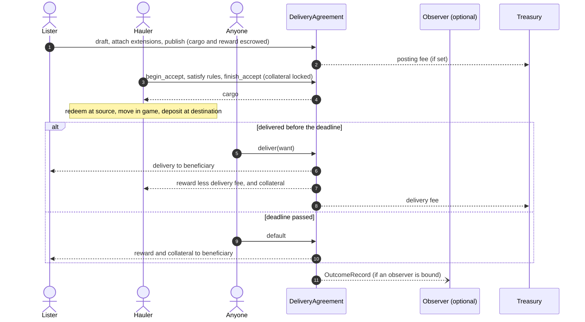

# Delivery agreements: user paths

Every way a player, service or extension author interacts with a delivery agreement, step by step. For the reasoning behind the design, see [design.md](design.md).

Code blocks show the commands of one programmable transaction block (PTB), written as Move calls. `delivery` is `delivery_agreements::delivery`, `config` is `delivery_agreements::config`, `spec` is `agreements::spec`, `request` is `agreements::request`, `claim` is `agreement_roles::claim`, `acl` is `roles::acl`, and `coin` is `sui::coin`. Times are milliseconds from the Sui `Clock`.

`T` is the agreement's currency: the coin type of its reward, collateral and delivery fee, which must be approved in the shared `Config`. `F` is the posting fee's coin type. A PTB passes `T` as a type argument to every call on a `DeliveryAgreement<T>` or `Draft<T>`, and `T` then `F` to `draft`, `post` and `claim::post_for`. Cargo and `want` are multicoin balances; only payments are coins.

## Who is involved

| Actor | What they do |
|---|---|
| **Lister** | Posts the agreement, funds the cargo and reward, and holds the `ListerCap`. |
| **Hauler** | Accepts, locks collateral, receives the cargo, and delivers or defaults. |
| **Beneficiary** | Receives the delivery, or the reward and collateral on default. Often the lister, but it can be a treasury. |
| **Anyone** | Can deliver on a hauler's behalf, trigger a default, or collect outcome records. |
| **Extension author** | Writes accept rules or observers. |
| **Config admin** | Holds the `config::AdminCap`, approves and revokes currencies, and sets the posting fee, delivery fee rate and treasury for new agreements. Can also close lapsed agreements, returning their escrow to the lister. |

## Which path do I need?

| I want to… | Path |
|---|---|
| Post a job anyone can take | [L1](#l1-post-an-open-agreement) |
| Post a job with rules or a track record | [L2](#l2-post-with-extensions) |
| Post a job for one player, my organisation's haulers, or both | [L3](#l3-limit-who-can-claim) |
| Take back a job nobody accepted | [L4](#l4-cancel) |
| Take a job | [H1](#h1-accept-an-open-agreement), [H2](#h2-accept-a-gated-agreement) |
| Do the haul and get paid | [H3](#h3-haul-and-deliver-with-warehouse-receipts) |
| Back out of a job I accepted | [H4](#h4-forfeit) |
| Fill an order with receipts I already have | [X1](#x1-deliver-for-someone-else) |
| Collect after a hauler fails | [X2](#x2-collect-a-default) |
| Build a reputation system | [O1](#o1-collect-outcome-records), [O2](#o2-index-events) |
| Write my own extension | [E1](#e1-write-an-accept-rule)–[E3](#e3-write-an-observer) |
| Approve currencies or set protocol fees | [A1](#a1-approve-currencies-and-set-fees) |
| Close a lapsed listing whose cap is lost | [A2](#a2-close-a-lapsed-agreement) |



---

## Lister paths

### L1. Post an open agreement

**When:** you want a job anyone can accept, with no extensions.

```move
let reward = coin::split(&mut my_coins, reward_amount, ctx);        // Coin<T>
let post_fee = coin::split(&mut my_fee_coins, post_fee_amount, ctx); // Coin<F>
let cap = delivery::post<T, F>(
    cargo,            // Balance: receipts from the source SSU's collection
    reward,           // Coin<T>: what the hauler earns
    spec::new(dest_collection, item_type, qty),      // want
    collateral,       // u64: the amount of T a hauler must lock
    accept_by_ms,     // absolute: last moment to accept (exclusive)
    haul_ms,          // relative: delivery window from acceptance
    beneficiary,      // who receives the delivery
    &config,          // the package's shared Config
    post_fee,         // Coin<F>: exactly the posting fee, or an empty coin if none is set
    &clock, ctx,
);
transfer::public_transfer(cap, lister);
```

- **Result:** a shared `DeliveryAgreement<T>` and an `AgreementPosted` event. Keep the `ListerCap`: it is the only way to cancel. It has `store`, so a DAO or vault can hold it.
- **Currency:** `T` must be approved; check with `config.is_approved<T>()` or list them with `config.currencies()`. Revoking `T` later doesn't affect this agreement.
- **Fees:** `post_fee` goes to the treasury at once and isn't refunded if you cancel. Read the current fee from `config.post_fee()`, which names its coin type and amount; when it is `none`, pass an empty coin of any type, such as `coin::zero<SUI>(ctx)`. The agreement also copies the config's delivery fee rate and treasury, and `AgreementPosted` shows all three.
- **Fails with:** `EInvalidTerms` if `accept_by_ms` isn't in the future or is more than 30 days away, `haul_ms` is 0 or more than 30 days, or the `want` quantity or `collateral` is 0. `config::ECurrencyNotApproved` if `T` isn't approved. `config::EWrongPostFeeCurrency` or `config::EWrongPostFeeAmount` if `post_fee` isn't exactly the posting fee, and `config::EUnexpectedFee` if no posting fee is set and `post_fee` isn't empty.
- **Pricing:** set collateral to at least the cargo's value plus the reward. The hauler holds the cargo from the moment they accept, and collateral is your only protection.

### L2. Post with extensions

**When:** you want rules on who may accept, or an observer that keeps a track record.

```move
let mut draft = delivery::draft<T, F>(cargo, reward, want, collateral, accept_by_ms, haul_ms,
    beneficiary, &config, post_fee, &clock, ctx);

// Who may accept, in the order an accepting PTB must satisfy them.
draft.require_to_accept(some_rule::requirement(config));
draft.require_identity_to_accept(character_rule::requirement());  // at most one

// An observer: its module collects its fee and binds itself.
ledger::bind(&ledger, &mut draft, fee);

let cap = draft.publish(ctx);
```

- **`Draft` has no abilities.** The PTB that drafts must also publish, so extensions can only be attached in between, and nothing can be changed afterwards.
- **Observers bind through their own module.** `bind_observer<T, O>` needs `Permit` of the observer's type, so you call the observer's bind function, not the core's.
- **Result:** `AgreementPosted` lists every requirement with its config, the identity rule and the observer binding.
- **Fees:** as in L1. An observer's fee is separate and collected by its own module.
- **Fails with:** `EIdentityRuleSet` for a second identity rule and `EAlreadyBound` for a second observer, plus L1's errors.

### L3. Limit who can claim

**When:** the job is for one player you've already agreed terms with, for your organisation's haulers, or for a mix. Uses [`agreement_roles`](../../packages/extensions/agreement_roles).

```move
// One player only (a reservation), in one call: draft, gate, publish.
let cap = claim::post_for<T, F>(cargo, reward, want, collateral, accept_by_ms, haul_ms,
    beneficiary, vector[acl::player(player_address)], &config, post_fee, &clock, ctx);

// Or on a draft, alongside other extensions: the haulers OU's board, a
// freelancer and a courier bot.
claim::require_to_claim(&mut draft,
    vector[acl::ou(haulers_ou_id), acl::player(freelancer), acl::machine(bot)]);
```

- **Principals** come from the shared `roles::acl` package, which copies `armature_vault`'s: `Player { addr }`, `Machine { addr }`, or `Ou { ou_id }`, meaning any current board member of that OU.
- **Result:** only an actor who satisfies one of the principals can complete an accept. Anyone else aborts with `claim::ENotAuthorized`. Each successful claim emits `claim::Claimed`, naming the principal matched.
- **What can change after posting:** an `Ou` principal is checked at claim time, so board changes apply to open agreements at once. The list itself is fixed; to change it, cancel and repost.
- **Fails with:** `claim::EInvalidPrincipals` for an empty list or more than 32 principals, plus L1's errors.
- **To reserve for an in-game character instead of a wallet,** write a rule against a world `AccessCap` and attach it with `require_identity_to_accept` (see [E2](#e2-write-an-identity-rule)).

### L4. Cancel

**When:** nobody has accepted yet, including after `accept_by_ms` has passed (the agreement has lapsed).

```move
let (cargo, reward) = agreement.cancel(cap, &clock, ctx);   // Balance, Coin<T>
```

- **Result:** the cargo and the reward coin are returned to the cap holder, the agreement is deleted, and `AgreementCancelled` is emitted. A bound observer receives a `Cancelled` record. The posting fee is not refunded.
- **Fails with:** `ENotOpen` once a hauler has accepted, and `EWrongCap` for another agreement's cap.
- **If the cap is lost,** the config admin can close the agreement once it lapses, sending the cargo and reward to the address that signed `draft` ([A2](#a2-close-a-lapsed-agreement)).

---

## Hauler paths

### H1. Accept an open agreement

**When:** `AgreementPosted.accept_requirements` is empty.

```move
let collateral = coin::split(&mut my_coins, agreement.collateral_amount(), ctx);   // Coin<T>
let cargo = agreement.accept(collateral, &clock, ctx);
```

- **Before accepting,** check that `want.collection` really is the destination SSU's receipt collection and that you can redeem the cargo at the source. The contract checks neither. Also check `currency` and `delivery_fee_bps` in `AgreementPosted` (or `agreement.currency()` and `agreement.delivery_fee_bps()`): you are paid in that coin, and that share of the reward goes to the treasury when you deliver.
- **Result:** the cargo is returned to you, the collateral is locked, and `deadline_ms = now + haul_ms`. `AgreementAccepted` is emitted.
- **Fails with:** `ENotOpen` if someone accepted first, `ETooLate` at or after `accept_by_ms`, `EWrongCollateral` for a coin that isn't exactly `collateral_amount`, and `request::ERequestNotComplete` if the agreement has requirements (use H2).

### H2. Accept a gated agreement

**When:** the agreement has accept requirements. Satisfy them in the order `accept_requirements` lists them, all in one PTB.

```move
let mut req = agreement.begin_accept(&clock, ctx);
claim::satisfy(&mut req, &my_ou);             // requirement 1: a claim gate, as an OU member
some_rule::satisfy(&mut req, &my_profile);    // requirement 2: whatever rule comes next
let cargo = agreement.finish_accept(req, collateral, &clock);
```

The same transaction with the TypeScript SDK (a sketch). `coinType` is the agreement's `T`, from the object's type `DeliveryAgreement<T>`:

```ts
const tx = new Transaction();
const req = tx.moveCall({
  target: `${KIT}::delivery::begin_accept`,
  typeArguments: [coinType],
  arguments: [tx.object(agreementId), tx.object.clock()],
});
tx.moveCall({
  target: `${ROLES}::claim::satisfy`,
  arguments: [req, tx.object(myOuId)],
});
const [collateral] = tx.splitCoins(tx.object(myCoinId), [tx.pure.u64(collateralAmount)]);
const cargo = tx.moveCall({
  target: `${KIT}::delivery::finish_accept`,
  typeArguments: [coinType],
  arguments: [tx.object(agreementId), req, collateral, tx.object.clock()],
});
tx.transferObjects([cargo], myAddress);
```

- **How a client knows what to call:** each requirement's type name identifies the rule's package and module, and its config is BCS-encoded in `data`. A client keeps a map from rule type to the satisfy call it knows how to build.
- **The `Request` has no abilities,** so the PTB can't end until `finish_accept` consumes it. It also can't be finished on a different agreement (`request::EWrongAgreement`) or used for a different action (`request::EWrongAction`).
- **Listed directly as a player or machine?** Use `claim::satisfy_directly(&mut req)`, which needs no OU.
- **Fails with:** `request::EWrongRequirementType` for satisfying out of order, `request::ERequestNotComplete` for skipping one, `request::EIdentityMissing` if the identity rule didn't record an identity, or the rule's own error, such as `claim::ENotAuthorized`.

### H3. Haul and deliver with warehouse receipts

**When:** you hold the cargo receipts and want to be paid. Delivery is a type-and-amount check, so how the goods travel is up to you.

```move
// At the source SSU (any time after accepting):
warehouse_receipts::receipt::redeem_receipt(/* source vault, cargo receipts, ... */);

// ...move the items in game...

// At the destination SSU, in one PTB:
let delivered = warehouse_receipts::receipt::deposit_for_receipt(/* destination vault, items, ... */);
agreement.deliver(delivered, &clock, ctx);
```

- **Result:** the delivered receipts go to the beneficiary. The delivery fee, `reward * delivery_fee_bps / 10,000` rounded down, goes to the agreement's treasury, and the rest of the reward and the collateral go to you, as coins of `T`. A zero amount, such as a delivery fee at a rate of 0, isn't sent. The agreement is deleted, and `AgreementDelivered` and an observer record are produced. The event's `reward` is what you received, and `delivery_fee` is what the treasury received.
- **Fails with:** `ETooLate` at or after `deadline_ms`, and `spec::EWrongAsset` or `spec::EWrongAmount` unless the balance is exactly `want`. Handing back the source receipts is not delivery.

### H4. Forfeit

**When:** you accepted but won't deliver, and want to release the funds now instead of waiting for the deadline.

```move
agreement.forfeit(&clock, ctx);   // only the hauler
```

- **Result:** the reward and collateral go to the beneficiary now, with no fee taken, and you keep the cargo. `AgreementDefaulted { forfeited: true }` is emitted, and a bound observer receives the record. Forfeiting doesn't hide the failure.

---

## Anyone and the beneficiary

### X1. Deliver for someone else

**When:** you hold receipts that match `want`, for example ones bought on a market. `deliver` is permissionless and its recipients are fixed, so the hauler is still paid the reward less the delivery fee, and the fee still goes to the agreement's treasury. Pair it with a private arrangement with the hauler if you want to be paid yourself.

```move
agreement.deliver(receipts_matching_want, &clock, ctx);
```

### X2. Collect a default

**When:** an accepted agreement is at or past its `deadline_ms`.

```move
agreement.default(&clock, ctx);   // anyone; the beneficiary usually has the motive
```

- **Result:** the reward and collateral go to the beneficiary, with no fee taken. `AgreementDefaulted { forfeited: false }` is emitted.
- **Fails with:** `ETooEarly` before `deadline_ms`, and `ENotAccepted` on an open agreement (cancel it instead).
- **There's no event while overdue.** Find overdue agreements by comparing `deadline_ms` (in `AgreementAccepted`) with the latest checkpoint's time.

---

## Observer paths

### O1. Collect outcome records

**When:** you run an observer, such as a reputation ledger. Every terminal transition of an agreement bound to your observer sends an `OutcomeRecord` object to your instance object's address. Collect records whenever you like, for example with a permissionless crank.

```move
// In the observer's module:
public fun ingest(ledger: &mut Ledger, ticket: Receiving<OutcomeRecord>) {
    let record = delivery::receive_outcome(internal::permit<Ledger>(), &mut ledger.id, ticket);
    // read record_outcome, record_observer().binding_fee(), record_currency(), record_reward(), ...
    // trust record_hauler_identity only if record_identity_rule is a rule you trust
    record.delete_outcome();
}
```

- **Find pending records** by listing objects owned by the instance's address.
- **Fails with:** `EWrongObserver` for a record bound to a different observer type that merely pointed at your instance. Ignore those; they stay in your inbox and can't be counted.
- **Weight by fee, not count.** Completing a job between two of your own accounts costs only the fees.

### O2. Index events

**When:** you want failure rates or history off-chain, with or without an on-chain observer.

| Question | Events |
|---|---|
| Open jobs | `AgreementPosted` minus terminal events, filtered by `accept_by_ms` |
| A hauler's failures | `AgreementDefaulted` by `hauler` or `hauler_identity`; `forfeited` tells a hauler who gave up from one who disappeared |
| A hauler's completions | `AgreementDelivered` by `hauler` or `hauler_identity`; its `reward` is net of the delivery fee |
| Fees paid | `AgreementPosted.post_fee` (its own coin type and amount) and `AgreementDelivered.delivery_fee` (in the event's `currency`), each with its `treasury`; config changes from `config::ConfigUpdated` |
| Approved currencies | `config::ConfigUpdated.currencies`, the whole list after each change |
| Which rules an agreement uses | `AgreementPosted.accept_requirements`, `.identity_rule`, `.observer` |
| Who may take a gated job | The claim gate in `AgreementPosted.accept_requirements`, decoded with `claim::principals_of`; for `Ou` principals, the OU's board from armature's board events |
| Which OU a gated job was taken for | `claim::Claimed.principal` (an `Ou` principal), joined to `AgreementAccepted` by `agreement_id` |
| Overdue jobs | No event: `AgreementAccepted.deadline_ms` before the latest checkpoint time, with no terminal event |

Terminal events delete the agreement, so index from the package's publish checkpoint.

---

## Extension author paths

### E1. Write an accept rule

A rule is a config type plus a satisfy function in the same module.

```move
public struct MinRank has drop { min: u64 }

public fun requirement(min: u64): Requirement { requirement::from_config(MinRank { min }) }

public fun satisfy(request: &mut Request, profile: &Profile) {
    let (req, frame) = request.take_next(internal::permit<MinRank>());
    let min = bcs::new(req.data()).peel_u64();
    assert!(profile.owner() == request.actor() && profile.rank() >= min, ETooJunior);
    frame.destroy_empty_frame();   // or frame.require(...) then request.enqueue(frame)
}
```

- **Only your module can satisfy your requirement,** because only it can create `Permit<MinRank>`.
- **Check `request.is_action<delivery::AcceptAction>()`** if the rule should only gate delivery accepts, not other agreement types' actions. `claim` doesn't, so one gate works for every action of every agreement type.
- **Follow-ups:** push requirements onto the `Frame` and `enqueue` it. They resolve next, in the order you added them. Enqueue or destroy the frame inside your satisfy function; it only goes back onto a request for the same agreement and action (`EWrongFrame`).

### E2. Write an identity rule

The same as E1, plus recording the actor's identity. The lister must attach it with `require_identity_to_accept`.

```move
public fun satisfy(request: &mut Request, cap: &AccessCap) {
    let (_, frame) = request.take_next(internal::permit<CharacterRule>());
    // check the cap belongs to the sender's character, then:
    request.set_identity(internal::permit<CharacterRule>(), cap.entity());
    frame.destroy_empty_frame();
}
```

`set_identity` aborts unless your type is the agreement's identity rule (`ENotIdentityRule`), and accepting aborts if no identity was recorded (`EIdentityMissing`). If the same rule can also be attached as a plain requirement, check `request.identity_rule()` first and only set the identity when it names your type.

### E3. Write an observer

1. **A shared object** to receive records, for example a `Ledger`.
2. **A bind function** that collects your fee and calls `draft.bind_observer(internal::permit<Ledger>(), object::id(ledger), option::some(fee_spec))`.
3. **An ingest function** as in [O1](#o1-collect-outcome-records).
4. **Optionally, a claim rule** (E1) that reads the ledger, such as "at least 10 fee-weighted completions", so listers can gate on reputation.

The test package's [`test_extensions.move`](../../packages/composites/delivery_agreements/tests/test_extensions.move) has a working version of each of E1–E3.

---

## Config admin path

### A1. Approve currencies and set fees

**When:** you hold the `config::AdminCap`. The publisher receives it, and it has `store`, so a DAO can hold it. The config starts with no approved currencies, no posting fee, a delivery fee of 0 and the publisher as treasury. Nothing can be drafted until at least one currency is approved.

```move
config::approve_currency<T>(&admin_cap, &mut config);          // allow agreements paid in T
config::revoke_currency<T>(&admin_cap, &mut config);           // stop new agreements in T
config::set_post_fee<F>(&admin_cap, &mut config, amount);      // flat posting fee in coin type F
config::clear_post_fee(&admin_cap, &mut config);               // or turn it off
config::set_delivery_fee_bps(&admin_cap, &mut config, bps);    // share of the reward, out of 10,000
config::set_treasury(&admin_cap, &mut config, treasury);
```

- **Result:** each call emits `ConfigUpdated` with the whole config, including the list of approved currencies. Changes apply to agreements drafted afterwards. Existing agreements, open or accepted, keep their currency, delivery fee rate and treasury, even if their currency is revoked.
- **Listers pay the new posting fee at once:** a draft built for the old fee aborts, because the fee must match exactly in coin type and amount. A draft in a currency revoked before it executes aborts too.
- **Fails with:** `config::ECurrencyAlreadyApproved` when approving an approved currency, `config::ECurrencyNotApproved` when revoking one that isn't, `config::EInvalidBps` above 10,000 bps, and `config::EInvalidPostFee` for a posting fee of 0 (use `clear_post_fee`).

### A2. Close a lapsed agreement

**When:** nobody accepted an open agreement before its `accept_by_ms`, and its lister can't cancel it, for example because the `ListerCap` was lost or is held by a wrapper with no way to cancel.

```move
agreement.close_lapsed(&admin_cap, &clock, ctx);   // the config::AdminCap
```

- **Result:** the cargo and reward go to the agreement's `lister`, the address that signed `draft`, never to the caller. The agreement is deleted and `AgreementLapsed` is emitted. A bound observer receives a `Lapsed` record. No fee is taken and the posting fee is not refunded. An empty cargo or a zero reward isn't sent.
- **Refunds follow the signer, not the cap.** If a DAO or other wrapper listed through its own signer and holds the cap, the refund lands at that signer's address. Such a lister should cancel with its cap instead.
- **Fails with:** `ENotLapsed` before `accept_by_ms`, and `ENotOpen` once a hauler has accepted.
