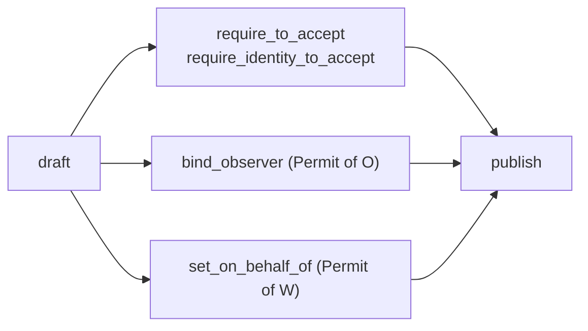

# hauling_agreements

Minimal on-chain agreements built only on [MultiCoin](https://github.com/Algorithmic-Warfare/multicoin), the shared [agreements](../../primitives/agreements) primitive and the Sui framework. Items are multicoin balances; payments are Sui coins in an admin-approved currency.

- [docs/agreements/design.md](../../../docs/agreements/design.md): the full design, its guarantees and how it is meant to be extended.
- [docs/agreements/user-paths.md](../../../docs/agreements/user-paths.md): every user path, step by step.
- [agreement_roles](../../extensions/agreement_roles): limit who can claim an agreement to a list of principals (one player, machine keys or an OU's board), as armature_vault does.

## `hauling_agreements::hauling`

A hauling agreement is a forward swap of items between two lists of multicoin balances, backed by collateral and paid in one coin type `T`: a `HaulingAgreement<T>`. `T` must be approved in the shared `Config` when the agreement is drafted (see [Config](#hauling_agreementsconfig)).

1. **`draft`, then `publish`**: the lister escrows `cargo` (a `vector<Balance>`: one nonempty multicoin balance per item, each a different collection and asset, at most 32, or none for an agreement that only pays for delivery; `EInvalidCargo` otherwise) and a `reward` (a `Coin<T>`) on [`Terms`](#hauling_agreementsterms): the `want` (an exact collection, asset and quantity for each item that counts as delivery, none naming a collection and asset the cargo holds, so cargo can't be handed back), the collateral a hauler must lock (an amount of `T`), an accept window from drafting and a haul window from accepting, each at most 30 days (`terms::max_duration_ms`), and who receives the lister's side of the payouts. They also pay the posting fee, if one is set. Extensions are attached between the two calls (see [Extensions](#extensions)). `publish` shares the agreement and returns its `ListerCap`. `post` does both for an agreement with no extensions.
2. **`accept`**: a hauler locks a `Coin<T>` of exactly the collateral amount (`EWrongCollateral` otherwise) and receives the cargo at once, as a `vector<Balance>` in the order it was escrowed. The deadline is the accept time plus the haul window. If the agreement has accept requirements, use `begin_accept`, satisfy them, then `finish_accept`.
3. **`deliver`**: anyone hands in exactly the `want` balances before the deadline, one per `want` entry in `want`'s order (`spec::EWrongCount` for a different number, then `spec::EWrongAsset` or `spec::EWrongAmount`). It is all or nothing: a partial delivery aborts and pays nothing. The balances go to the beneficiary (see [Terms](#hauling_agreementsterms)), the delivery fee goes to the treasury, and the rest of the reward plus the collateral go to the hauler. The agreement is deleted.
4. **`default`**: after the deadline, anyone can send the reward and collateral to the beneficiary. The agreement is deleted.
   - **`forfeit`**: the hauler can trigger the same payout before the deadline, for example after deciding not to do the haul. Only the hauler can call it, and only while `now < deadline_ms` (`ETooLate` after), so a missed deadline is always recorded as a default, not a forfeit. `default` stays open to anyone, so the funds never depend on a hauler who has walked away.
5. **`cancel`**: while the agreement is still open, the `ListerCap` holder gets the cargo `vector<Balance>` and the reward `Coin<T>` back. The agreement and the cap are deleted.
6. **`close_lapsed`**: once `accept_by_ms` has passed with nobody accepting, the config `AdminCap` holder can delete the agreement. The cargo and reward go to the lister, the address that signed `draft`, or to the cap for terms that pay the cap holder, never to the admin. So a listing whose `ListerCap` is lost or burned still ends, but only terms with a beneficiary address get the escrow back: for terms that pay the cap holder, the refund goes to the lost cap. With a beneficiary address the refund follows the signer of `draft`, not the cap, so a wrapper that drafts through another signer should use terms that pay the cap holder. A holder can still `cancel` a lapsed listing, and the first transaction wins, so the admin should close only listings lapsed long enough that a holder would have cancelled. It aborts with `ENotLapsed` before `accept_by_ms` and `ENotOpen` after an accept.

`cancel` consumes the `ListerCap`, and so does `collect` for terms that pay the cap holder. After any other ending, the holder of a cap for a beneficiary address can delete it with `delete_cap` and get its storage back. Deleting it while the agreement is open gives up the right to cancel.

Payouts are coins of `T`. A zero amount isn't sent, so nobody receives an empty coin.

Items move as a `vector<Balance>`, one balance per item, and keep the agreement's order: `accept`, `finish_accept`, `cancel` and `collect` return them in that order, and events, outcome records and `Proceeds` list them in it. In a PTB, build `want` and the cargo or delivery with `MakeMoveVec`. A returned `vector<Balance>` isn't an object, so send it to one address with `agreements::payout::pay_all`, or take balances out with `0x1::vector::pop_back` and destroy the empty vector with `0x1::vector::destroy_empty`.

## `hauling_agreements::terms`

An agreement's terms as one value, `Terms`: the `want`, the collateral, `accept_ms`, `haul_ms` and who receives the lister's side. It has `store`, so a wrapper can keep terms in its own objects, such as a governance payload, and pass them to `draft` or `post` later. Both windows are relative: the accept window starts at `draft`, which records the absolute `accept_by_ms`, and the haul window at accept. So stored terms never expire, and `agreement.terms()` returns terms the cap holder can post again after cancelling, even once the listing has lapsed.

- **`terms::new(want, collateral, accept_ms, haul_ms, beneficiary)`** pays the address `beneficiary`: the delivered `want` goes there, and so do the reward and collateral on default or forfeit.
- **`terms::new_for_cap_holder(want, collateral, accept_ms, haul_ms)`** pays the agreement's `ListerCap` instead. `draft` creates the cap with the agreement, so the agreement's `beneficiary()` is the cap's own address. Everything the lister's side receives, including the cargo and reward of a listing the admin closes with `close_lapsed`, arrives there as one `Proceeds<T>`, and whoever holds the cap opens it with `collect(cap, proceeds)`. That returns `(vector<Balance>, Coin<T>)`, the items empty after a default or forfeit, and deletes the proceeds and the cap. `cancel` still returns the escrow directly. `delete_cap` aborts with `ECapReceivesProceeds` for such a cap, since deleting it would strand its proceeds.
- **`want` is a `vector<Spec>`** of 1 to `terms::max_items()` (32) entries, each more than 0 and each a different collection and asset. A delivery hands in one balance per entry, in this order.
- **Checks.** The constructors abort with `terms::EInvalidTerms` for an `accept_ms` or `haul_ms` of 0 or over 30 days, a zero collateral, or a `want` that is empty, over 32 entries, has an entry of 0 or names the same collection and asset twice. `draft` aborts with the same code when any `want` entry names a collection and asset the cargo holds.

Paying the cap holder is for listers that aren't one wallet: a DAO, a custody object or a vault that holds the cap receives every payout without receiving code of its own, whichever key signed `draft`, and the result of `collect` composes in the same transaction, for example into a vault deposit. It also makes a listing transferable with its payouts.

There is no dispute step: delivery is a check of each balance's type and amount.

## `hauling_agreements::config`

Approved currencies and protocol fees, set in one shared `Config` created at publish. There is no public constructor, so every agreement is drafted against that config. It starts with no currencies, no fees and the publisher as treasury, so nothing can be drafted until a currency is approved.

- **Approved currencies**: the coin types an agreement may be paid in. `draft<T, F>` aborts with `ECurrencyNotApproved` unless `T` is approved. Revoking a currency stops new agreements in it; agreements already drafted in it run to the end unchanged. Check with `is_approved<T>()` or `currencies()`.
- **Posting fee**: a flat amount in one configured coin type `F` (`post_fee: Option<PostFee { currency, amount }>`) that the lister pays when drafting. `draft` and `post` take `config: &Config, post_fee: Coin<F>` after `terms`. The coin must match the fee exactly (`EWrongPostFeeCurrency`, `EWrongPostFeeAmount`), or be empty, of any type, when there is none (`EUnexpectedFee`). It goes to the treasury at once and is not refunded on cancel.
- **Delivery fee**: `floor(reward * delivery_fee_bps / 10,000)`, taken from the reward at `deliver` and sent to the treasury, in `T`. The hauler gets the rest. `default`, `forfeit`, `cancel` and `close_lapsed` take no fee.
- **Fixed per agreement.** Each agreement copies the delivery rate and treasury when drafted, so config changes never alter existing agreements, open or accepted. Read them with `delivery_fee_bps()` and `treasury()` on the agreement, or from `AgreementPosted`.
- **`AdminCap`** changes the config with `approve_currency<T>` (`ECurrencyAlreadyApproved` if it already is), `revoke_currency<T>` (`ECurrencyNotApproved` if it isn't), `set_post_fee<F>` (`EInvalidPostFee` for 0), `clear_post_fee`, `set_delivery_fee_bps` (`EInvalidBps` above 10,000) and `set_treasury`. Each emits `ConfigUpdated` with the whole config, including the currency list. The publisher receives the cap; it has `store`, so a DAO can hold it. The cap also closes lapsed agreements with `hauling::close_lapsed`.

## Extensions

Three optional extensions. Each is attached to the `Draft`, so it is fixed before anyone commits funds, and none can stop an agreement from ending.



### Accept requirements: who may accept

Built on `agreements::request` and `agreements::requirement`, adapted from the `Request`/`Requirement` pattern in world-contracts `dev` (`core::request`, `core::requirement`). The same rules can gate other agreement types built on `agreements`.

- A `Requirement` is a type name plus a BCS-encoded config. Only the module that defines the config type can satisfy it, because satisfying needs `Permit` of that type.
- `begin_accept` returns a `Request` with no abilities. Rule modules satisfy its requirements in declaration order with `take_next`. A rule can add follow-up requirements through the returned `Frame`, which resolve next. A frame can only be enqueued back onto a request for the same agreement and action.
- `finish_accept` completes the request. It aborts unless every requirement is satisfied and the request was created for this agreement and this action, so a request satisfied against a loosely gated agreement can't be finished on a strictly gated one.
- Actions are marker types; hauling's is `AcceptAction`. Only this module can create `Permit` of it, so only it can open or complete its requests. A rule that should gate hauling-agreement accepts only can check `request.is_action<AcceptAction>()`.
- `accept` is `begin_accept` plus `finish_accept`. It aborts when requirements exist, so they can't be bypassed.
- **Identity.** `require_identity_to_accept` also trusts that rule to record the hauler's identity with `set_identity`, for example the character ID behind a world `AccessCap`. An agreement has at most one identity rule, and an accept can't complete until it records an identity, exactly once. Don't also attach the identity rule with `require_to_accept`, and name only a rule that calls `set_identity`: either makes every accept abort. Identity appears in `AgreementAccepted`, the terminal events and outcome records. `AgreementAccepted` and outcome records also carry the `identity_rule` that attested it. The lister chooses that rule, so trust an identity only from rules you trust. Key reputation by it: a wallet address is free to replace.

```move
let mut req = agreement.begin_accept(&clock, ctx);
member_rule::satisfy(&mut req, dao);             // takes Permit of its config type
character_rule::satisfy(&mut req, &access_cap);  // records the character ID
let cargo = agreement.finish_accept(req, collateral, &clock);
```

### Observer: an unforgeable track record

- `bind_observer<T, O>(draft, Permit<O>, instance, fee)` can only be called by `O`'s module. That module collects its fee in the same call and declares it as `fee`. This package never holds extension fees.
- Every terminal transition (`deliver`, `default`, `forfeit`, `cancel`, `close_lapsed`) sends an `OutcomeRecord` object to the `instance` object's address. The record holds the outcome, parties, hauler identity and the rule that attested it, the observer binding with its declared fee, the cargo and want specs, the `currency` with the `reward` and `collateral` amounts, and timestamps. The reward is the escrowed reward, before any delivery fee; the collateral is `none` if the agreement was cancelled or lapsed before anyone accepted.
- The record also carries `on_behalf_of`, the entity a wrapper vouched the lister drafts for (see below).
- The observer collects records whenever it likes with `receive_outcome<O>(Permit<O>, &mut UID, Receiving<OutcomeRecord>)`. That aborts for records bound to a different observer type, so another extension type can't fill a real observer's inbox with records it would count.
- Closing an agreement never runs observer code, so a buggy or hostile observer can't freeze funds. Nobody can suppress a record either: a hauler who forfeits still generates their failure record.
- Each record is a separate object, so there is no contention on one shared object.

### On behalf of: who the lister drafts for

- `set_on_behalf_of<T, W>(draft, Permit<W>, entity_id)` can only be called by `W`'s module, a wrapper that drafts for an entity, such as a DAO's governance handler run by one of its members. The agreement stores `Entity { kind, id }`, with `W` as `kind`, and `AgreementPosted` and every outcome record carry it, so indexers and observers can credit the entity rather than whichever member signed `draft`. It can be set once (`EAlreadyBound`).
- The wrapper's module must check that the signer speaks for `entity_id`; this package only records which module vouched. Trust an entity only from wrappers you trust.
- It moves no payout. To route payouts to the wrapper, use terms that pay the cap holder and keep the cap.

**Fees are what give records weight.** Reward and collateral must be in an approved currency, but completing a job between two of your own accounts still costs nothing but the observer's fee, the posting fee and the delivery fee, because the reward and collateral come back to you. An observer should weight completions by fees it collected in an asset it chooses, not count them.

## Events

`cargo`, `want`, `delivered` and `ProceedsCollected.items` are `vector<agreements::spec::Spec>`, one `Spec` (`{ collection, asset_id, qty }`) per item in the agreement's order. Build one with `spec::new`. `delivered` equals the agreement's `want`, and `items` is empty after a default or forfeit, or for a lapsed listing with no cargo. `reward`, `collateral` and `delivery_fee` are `u64` amounts of `currency`, the agreement's coin type `T` as a `TypeName`. `post_fee` is `Option<PostFee { currency, amount }>`, in its own coin type.

| Event | Fields | Emitted by |
|---|---|---|
| `AgreementPosted` | `agreement_id`, `lister`, `on_behalf_of`, `cap_id`, `beneficiary`, `pays_cap_holder`, `cargo`, `want`, `currency`, `reward`, `collateral`, `posted_at_ms`, `accept_by_ms`, `haul_ms`, `accept_requirements`, `identity_rule`, `observer`, `post_fee`, `delivery_fee_bps`, `treasury` | `publish` |
| `AgreementAccepted` | `agreement_id`, `hauler`, `hauler_identity`, `identity_rule`, `deadline_ms` | `finish_accept` |
| `AgreementDelivered` | `agreement_id`, `lister`, `hauler`, `hauler_identity`, `beneficiary`, `delivered`, `currency`, `reward`, `collateral`, `delivery_fee`, `treasury`, `proceeds_id` | `deliver` |
| `AgreementDefaulted` | `agreement_id`, `lister`, `hauler`, `hauler_identity`, `beneficiary`, `currency`, `reward`, `collateral`, `forfeited`, `proceeds_id` | `default` (`forfeited = false`), `forfeit` (`forfeited = true`) |
| `AgreementCancelled` | `agreement_id`, `cancelled_by`, `cargo`, `currency`, `reward` | `cancel` |
| `AgreementLapsed` | `agreement_id`, `lister`, `refunded_to`, `closed_by`, `cargo`, `currency`, `reward`, `proceeds_id` | `close_lapsed` |
| `ProceedsCollected` | `agreement_id`, `cap_id`, `proceeds_id`, `collected_by`, `items`, `currency`, `coins` | `collect` |
| `ListerCapDeleted` | `agreement_id`, `cap_id`, `deleted_by` | `delete_cap` |
| `config::ConfigUpdated` | `config_id`, `currencies`, `post_fee`, `delivery_fee_bps`, `treasury` | `approve_currency`, `revoke_currency`, `set_post_fee`, `clear_post_fee`, `set_delivery_fee_bps`, `set_treasury` |

- **Final events are self-contained.** `Delivered`, `Defaulted`, `Cancelled` and `Lapsed` delete the agreement object, so each one records who received what. A deleted agreement can't be read back by ID afterwards, so index from the package's publish checkpoint.
- **Terms that pay the cap holder** show as `pays_cap_holder` in `AgreementPosted`. The `beneficiary` in every event is then the cap's address, `AgreementLapsed.refunded_to` is too, and the payout waits there as the `Proceeds` named by the ending's `proceeds_id` until `collect` emits `ProceedsCollected`. `proceeds_id` is `none` for terms with a beneficiary address.
- **Every end of a cap has an event:** `AgreementCancelled`, `ProceedsCollected` or `ListerCapDeleted`. Transfers of the cap have none, so read its current holder from the object's owner.
- **`AgreementDelivered.reward` is what the hauler received**, after the fee. It plus `delivery_fee` is the escrowed reward.
- **`AgreementPosted` carries every requirement with its config**, in the order an accepting transaction must satisfy them, so a client can build the transaction without reading the object.
- **`lister` is the sender of `draft`.** It can differ from `beneficiary`, for example when a DAO lists for its treasury. `on_behalf_of` names the entity a wrapper vouched the lister drafts for, if any.
- **Failure rates are indexable.** `AgreementDefaulted` with `hauler` or `hauler_identity` is a failure; `forfeited` tells a hauler who gave up from one who disappeared.
- **Two states have no event.** An open agreement past `accept_by_ms` is *lapsed* until the cap holder cancels it or the config admin closes it with `close_lapsed` (which emits `AgreementLapsed`). An accepted agreement past `deadline_ms` is *overdue* until someone calls `default`. Derive both from the latest checkpoint's timestamp.

## Hauling with warehouse receipts

A [warehouse receipt](https://github.com/loash-industries/warehouse-receipts) is a multicoin `Balance` whose collection identifies its Storage Unit and whose asset ID is the item type. A haul from SSU A to SSU B is an agreement with:

- `cargo` set to receipts from A's collection, one balance per item type,
- `want` set to the same item types and quantities in B's collection.

The hauler accepts, redeems at A, moves the items however they like, then deposits each item at B with `deposit_for_receipt` and calls `deliver` with the receipts in `want`'s order. The last two steps can share one transaction. Delivering receipts bought on a market is equally valid, because the beneficiary receives the same claim.

## What the contract does not check

- **Whether a collection is real.** The contract doesn't check that a collection is a warehouse-receipt vault, or that its extension is frozen. Before accepting, a hauler should confirm two things: that every `want` entry's collection belongs to the intended destination SSU, and that they can redeem the cargo.
- **Whether the collateral is enough.** There's no oracle. The lister prices the collateral. If it's below the cargo's value plus the reward, keeping the cargo is the hauler's rational choice.
- **Whether extensions are honest.** Rule and observer modules are trusted code chosen by the lister. The core checks that a permit's type and instance match the binding; the extension's own module must check that its caller speaks for that instance, and its declared fee is taken on trust. Inspect an agreement's requirements and bindings before accepting.
- **SSU loss.** If an SSU is unanchored or destroyed mid-haul, the hauler can't deliver and will default. Price that risk into the reward.
- **That the endpoints stay online.** Minting `want` needs the destination SSU online. Whoever controls it, often the lister, can take it offline until the deadline and collect the collateral by default. Before accepting, check who controls both SSUs.
- **Who the lister and hauler are beyond the signer.** They are the addresses that signed `draft` and the accept. The hauler is paid at that address. The lister's side goes to the beneficiary address in the terms, or to the `ListerCap` for terms that pay the cap holder, not to a DAO or other wrapper unless it holds that cap. `on_behalf_of` is the wrapper's word for whom the lister drafts, not something this package checks.
- **What currencies and fees future agreements use.** The `AdminCap` holder can approve or revoke any coin type, and set any posting fee, a delivery fee up to the whole reward, and any treasury, for agreements drafted afterwards. Haulers should read an agreement's `currency` and `delivery_fee_bps` before accepting.
- **Self-dealing.** One player with two wallets can complete an agreement with themselves. Outcome records include the cargo and want specs and the currency, reward and collateral so an observer can discount cheap or circular jobs.

## Gas

A sponsor pays about 0.0087 SUI net per delivered agreement, nearly all of it storage. The per-feature and per-agreement costs are in [docs/agreements/gas.md](../../../docs/agreements/gas.md). `python3 scripts/gas_harness.py run`, from the repo root, re-measures them on a local network.

## Upgrades

Shared agreements have no version field, so after an upgrade every earlier version's functions stay callable on open agreements, and an upgrade could add a function that moves escrow. Publish the package immutable (`sui::package::make_immutable` on the `UpgradeCap`), and ship fixes as a fresh publish at a cycle rollover.

## Dependency pin

`multicoin` is pinned to the same revision as warehouse-receipts and `agreements` (`2772c26`). On-chain, a `Balance` is only the same type if every package links the same published multicoin, so bump them together. `agreements` is a local dependency and is published first.

## Build & test

```bash
cd packages/composites/hauling_agreements
sui move build --build-env testnet_stillness
sui move test  --build-env testnet_stillness
```

`tests/test_config.move` defines a test coin `TOKEN` and wraps `draft` and `post` with a config that approves it and charges no fees, for tests that aren't about the config. `tests/config_tests.move` covers currencies and fees, `tests/terms_tests.move` the `Terms` constructors and reposting, and `tests/proceeds_tests.move` terms that pay the cap holder, through every ending and `collect`. `tests/test_extensions.move` holds minimal example extensions used by the tests: an allowlist rule, an identity rule, a rule that adds a follow-up, an observer ledger and a wrapper that drafts for an entity.
